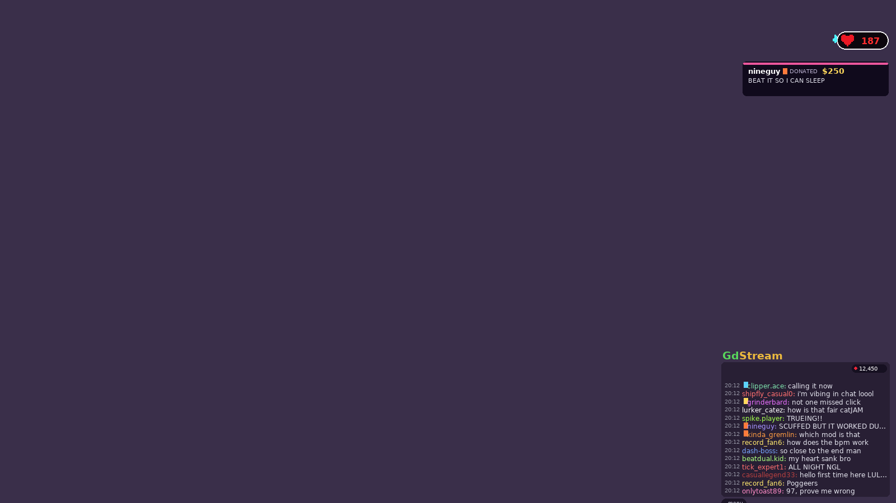
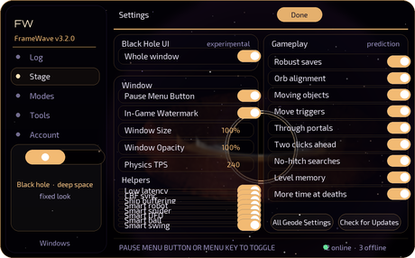

# FrameWave (Geode)

Formerly "Click Before Frames" (CBF). Same mod, new name: the in-game watermark is gone by default, and autoplay / updates no longer need the Discord link.

## Stream overlay: chat, viewers, donations, heart rate (v3.3)
A new **Stream** tab turns the game into a stream layout. Everything reads the real percentage from the level, so the chat gets louder, the donation alerts land harder and the heart rate climbs as the run goes deeper. Every piece has its own switch and each one can be on without the others.

**Nothing on the overlay is labelled.** There is no "fake" or "simulated" anywhere on screen: it shows `12,450` next to a red dot, a normal donation card, a normal BPM monitor. The words appear only in the settings page, where you'd expect them.

### What's on screen
- **Chat** (`300 x 240` by default, resizable): timestamps, a coloured username, a moderation icon on some names (mod / VIP / sub / founder), and the message. Lines wrap and the oldest scroll away. 5,200+ distinct lines across ten categories: normal talk, reactions, spam, emotes, predictions, hype, panic, celebrations, death reactions and personal-best reactions.
- **Viewer counter**: `4,281` with a live dot. Minimum, maximum, an exact value, or a random count that drifts.
- **Donations**: a card on the middle right with the donor's name, the amount (`$5` to `$1,000`, small tips common, big ones rare) and their message. 1,350+ messages, including ones that read the current percentage or attempt number.
- **Heart rate**: an ECG trace and a BPM pill on the right. It climbs with the run and, importantly, it doesn't count up by one: it jumps 3-7 BPM at irregular intervals (with the odd bigger correction when the gap is large), and eases back down after a restart instead of snapping to a resting rate.

### How the chat reacts
| Progress | What chat does |
| --- | --- |
| 0-10% | normal conversation between viewers |
| 10-30% | occasional encouragement, more predictions |
| 30-50% | reactions take over from small talk |
| 50-70% | hype, more messages per second |
| 70-85% | spam and caps, bursts of messages |
| 85-95% | panic, "PLEASE", "DON'T CHOKE" |
| 95-100% | maximum excitement |
| 100% | a wall of celebration that keeps going |

Deaths produce a reaction that scales with the percentage (a shrug at 10%, the whole chat screaming at 97%), new personal bests get their own category, and a completion floods the chat for a few seconds and usually pulls in a donation.

### Settings
- **Setup**: chat / viewers / donations / heart rate / timestamps on or off, the corner (four presets plus a free position), a layout preview, chat size, box size, opacity, and messages per second (Very slow to Max, or a custom rate).
- **Chat**: how many unique participants (10, 25, 50, 100, 250, 500 or any number up to 5,000) and the viewer counter's range. Participants and message rate are separate: the first decides how many different people type, the second decides how often chat moves.
- **Alerts**: donations, read-aloud, voice, volume, speed, delay, whether the message is read too, and the speech queue (one at a time, never overlapping, clearable).
- **Custom bots**: name, name colour (30 colours), icon, how often that bot talks relative to everyone else, and its own messages. Edit and delete them; they're saved to `stream-bots.txt` in the mod's save folder.
- **Custom donation messages**: your own lines, also saved (`stream-donations.txt`). `$P` becomes the percentage, `$A` the attempt number, `$L` the level's name.

### Positioning
In **Custom** the panel can be dragged anywhere, and the grip in its corner resizes it. A tap on the panel (without dragging) opens the menu, and there's a small **menu** chip on screen too, so it's reachable on a phone with no keyboard.

### Speech note
Read-aloud uses the system voice on macOS and iOS (`say`), on a worker thread, so a donation announcement never stutters the game. The Windows and Android builds report it as unavailable rather than linking a speech engine that could fail to load; everything else works the same there.

## Black Hole UI (experimental, off by default)
One switch (Settings → **Black Hole UI**, or the Geode setting of the same name) turns the whole window into deep space: a black hole with a photon ring, a lensed accretion disk that slowly streams round, a faint polar jet, the star field orbiting it, and sparks that spiral in. The window edge gets a violet halo, the panels turn to smoked glass, and the accent colour becomes the disk's gold. Everything else works exactly the same. Light mode, accent and background pickers are ignored while it's on (the hole has its own look).

## Stream overlay (new in v3.3)
A new **Stream** tab turns the game into a streamer's layout. Everything on screen reacts to your real run, and every part has its own switch.

**Chat.** A Twitch-style chat panel: coloured usernames, mod / VIP / sub / founder icons next to the names, timestamps, smooth wrapping and scrolling. The message pool is generated at startup and has **5,200+ distinct lines** across ten categories (chatting, reactions, spam, emotes, predictions, hype, panic, celebrations, death reactions, personal bests). Picking a line uses a shuffle bag: you see a category's lines in a different order each time, so nothing visibly repeats. The audience grows with your run: quiet chat at 0-10%, encouragement from 10%, hype from 50%, a wall of `GO` and `LOCK IN CHAT` from 85%, and a full celebration at the end.

**People.** `Chat Participants` picks how many unique accounts type (10 to 5,000), independently of `Messages Per Second` (very slow to extreme, or any rate from 0.2 to 60). Every bot has its own colour, icon, writing style (calm, all caps, stretched words, emote-heavy) and talkativeness. Custom bots: name, colour, icon, how often they speak and their own message list; they persist between sessions in `stream-bots.txt`.

**Monitors.** A BPM pill with a pixel heart and a live ECG trace, on the right. The rate climbs with your percentage (about 78 at 0% up to 205+ at 99%) but it moves the way a real watch does: irregular jumps of 3-7, uneven sampling intervals, small dips, and a slow settle on a restart instead of a snap.

**Alerts.** Donations appear on the middle right: username, amount (`$5` to `$1,000`, small amounts common and big ones rare), message and a draining progress bar. **1,350+ built-in donation messages**, plus your own (they can use `$P` for the percentage and `$A` for the attempt). Optional read-aloud on macOS and iOS in a worker thread, so the game never stutters; alerts queue up and never talk over each other.

**Viewers** is its own counter with minimum / maximum / exact / randomised modes and gradual drift, always inside the range you set.

**The overlay shows no feature labels.** It reads like a normal stream: `12,450` next to a red live dot, not "Fake Viewers". Only the settings pages use those words.

Moving it: pick a corner in the Stream tab, or choose `Custom Position` and drag the panel in game (the dots in its bottom-right corner resize it). A small `menu` chip sits on the overlay to open this window without the menu key.

Note: the chat, the viewers, the donations and the heartbeat are all simulated for looks. Nothing is sent anywhere and no money is involved.

## Keys
6 cycle stage | 7 menu | F8 copy the console log | F9 open/close the in-game console | F10 path view | F11 forget this level's memory | P macro playback toggle | O spam corrector toggle | I spam corrector panic

Practice use only; do not use for verified or leaderboard runs.

## v3.4: Macro Player and Alternate Spam Corrector

### Macro Player (new "Macros" tab)
A new **Macros** tab lets you play replay files directly, frame-accurate, in-game. Drop `.gdr2`, `.mhr`, `.xd`, or `.gdr` files into the macros folder and they appear in the list. Each macro gets its own keybind (press **bind**, then a key in-game) and an **arm** button. Press the macro's key during a level and it plays the recorded inputs through the game's own button path, so physics sees them as real presses. Supports both players on dual levels.

- **Formats**: GDR2 (Mega Hack, xdBot, Eclipse), MHR (Mega Hack replay JSON and binary), xdBot text, and the existing GDR v1 parser.
- **Per-macro keybinds**: any macro can be bound to any key. Conflicts are shown in red.
- **Global toggle**: keybind P turns macro playback on/off for the armed macro.
- **File list**: shows input count, fps, and parse errors. Refresh button rescans the folder.
- **Persistence**: the macro list and keybinds are saved to `macro-player/list.txt` in the mod's save folder.

### Alternate Spam Corrector
Alternate spamming (wave/ship flapping between two inputs) is fast enough that the normal buffer can't keep up. The corrector detects it from the press timing, then takes over: it blocks your raw inputs and generates clicks at a user-set rate so physics stays consistent. A panic key stops it at once.

- **Detection**: watches press gaps against a sensitivity-based threshold. A fast alternating pattern held for the detect time triggers the corrector.
- **ACTIVE**: blocks raw inputs (injected clicks pass through), generates press+release pairs at the set clicks/sec.
- **RELEASE**: when the player stops, waits the release time, then lets go and unblocks.
- **Reset**: on death, pause, level exit, and level complete.
- **Settings**: enable toggle, clicks/sec (1-200), detect time (0.2-2.0s), release time (0.2-2.0s), sensitivity (fast/medium/eager).

## v3.4.1: Pulse Trigger Repaint
A new **Repaint** tab lets you repaint every pulse trigger in the level at once. Pick any colour from the built-in colour picker and apply it: the mod finds every pulse trigger (object type 27) in the editor and sets its colour to the one you chose.

- **Colour picker**: opens Geode's built-in `ColorPickPopup` — RGB sliders, hex input, opacity.
- **Apply**: scans all editor objects, finds every pulse trigger, and repaints it.
- **Status**: shows how many pulse triggers were found and repainted.
- **Persistence**: the chosen colour is saved to the mod's settings (repaint-r/g/b).

## v3.0
- **Autoplay** (for showcases, test mode: nothing is saved as progress and AUTOPLAY stays on screen): plans a route up to 10 s ahead while it plays, a pathfinder for wave and ship, and it learns from its deaths.
- **Macros**: autoplay plays GD Replay (GDR) macros: your own in the Macros Folder, or one it downloads from [Hyperbolus](https://hyperbolus.net) (used with its owner's permission, every macro credited). It lines the macro up by itself, keeps you on its path with the bot's position records, plans the parts a macro dies in, and plays 2-player levels with each player's clicks.
- **Global brain**: a run autoplay finishes is shared, and every game's autoplay can play the runs others finished.
- **New window**: animations, an autoplay panel, an Account tab, and updates from the FrameWave site.
- **Online** (each can be turned off in the settings): an anonymous id with your device type and version every 90 s (the online counter), autoplay's finished runs (the level and the button presses), and linking the game to your Discord on the site. Linking is optional: autoplay and updates work without it, it only shows your stats on the site.

## v2.4 options (mod settings)
- Wave auto-release (practice only, off by default): lets go for you when holding would crash within the window and letting go survives.
- Orbs: also try the other choice: if a prediction dies after touching an orb, it is retried with the opposite click/skip choice.
- Don't buffer near moving objects (experimental, off by default): inputs are left untouched when the ghost's path hits recently moved spikes/blocks.
- Drift check (debug): logs in the in-game console how far you strayed from the prediction after each input.
- Wave (v2.7): cube-style. A crash you could still turn away from counts as safe; the smallest delay that clears the obstacle wins; inputs during a delay keep their rhythm. "Wave: old v4.6 logic" brings back the v4.6 rules. Platformer levels are never buffered.
- Orb alignment (v2.6): a press made up to 4 frames before an orb is held back until you're inside the orb, so it hits.
- v2.8: the ghost copies the full player state (slopes, reverse, sideways, forces, dash), size portals are simulated and mirror portals no longer stop the prediction.
- v2.10: wave tries 3 turn-away points, stops runs as soon as they are good enough (faster), and centers saves with a 1-tick safety margin. Console is see-through.
- v2.12 robot: presses count as safe if some hold length survives; robot auto-release (practice only).
- v2.13 level memory: learns per spot from your runs (delays that worked are tried first, spots where saves failed are left alone, risky spots marked in the path view).
- v2.15 spider: flips are judged by landing on the new surface, and crashes you could flip away from count as safe.
- v2.16 orbs: orbs usable on any tick inside them in predictions, orb alignment picks the best tick inside the orb, dash orbs held through in predictions, dash releases buffered, dash auto-release.
- v2.23 unlocked FPS: all windows (look-ahead, delays, landing, spam gap, auto-release window, memory) are converted from 240/s ticks to the real physics step rate, and the ghost uses the average step length.
- v2.24 FPS: prediction ghosts no longer spawn visual effects or leave nodes/actions behind (the FPS used to sink a little with every save).
- v2.25 ship (opt-in): ship presses/releases buffered with recovery-aware scoring, own small max delay, feathering passes through.
- v2.26 orb timing: presses already inside an orb are re-timed within the orb if that survives, learned orb timings are tried first, predictions try later clicks inside orbs.
- v2.27: late cube/ball crashes skip the search; experimental moving-object prediction (straight-line motion).
- v2.28 robust saves: each save is checked with the player slightly ahead/behind; fragile edge saves are swapped for a nearby delay that survives all three.
- v2.31: hazards overlapping you at the click (player-following spikes, noclip) are ignored by predictions.
- v2.34: with noclip, being inside a spike no longer makes the mod re-press the held button every tick.
- v2.35: Click Between Frames sync is back; low latency mode (no chained delays, max 1 frame, 3 ms searches).
- v2.36 CBF: rest of a split tick is collision-checked like the game does; logs show where in the tick a CBF click landed (@0.43) and separate 'safe' from 'safe only if you react by tX'.
- v2.37: position read from the per-step node position (CBF sync actually active now, drift check / path view / memory slices correct; memory restarts per level).
- v2.39: CBF Extrapolate is detected and shown in the console/export (it's visual only; predictions are unaffected).
- v2.40 UFO: crashes you could have flapped away from count as safe, landing counts as safe, smallest delay wins, spam guard for fast flapping.
- v2.41 FPS: moving-object tracking drops far objects and keeps a short moving-now list (was checking up to 4096 objects every step and every prediction).
- v2.43: more time at death spots - where you keep dying, react-only-safe inputs get the delay that pushes the crash furthest away.
- v2.44: in-game menu (pause menu 'Buffer' button or F7): stage, main switches, status, all settings / copy log / forget level. Ship: own spam gap (feathering is buffered), max delay 4, on by default.
- v2.45 ball: short flips count as landings, landings must last 8 ticks, spam guard for fast flipping; menu switch.
- v2.46 watermark (always on, not configurable): 'Basu Input Buffer | stage' in the level while the buffer is on, and 'Basu Input Buffer was on' on the level complete screen if it was on during the attempt.
- v2.49: ghost no longer touches collision blocks (could break collision triggers); spam guard sends waiting inputs instead of dropping them (lost clicks broke click/event triggers).
- v2.50: cuter menu: pink theme, pulsing hearts, floating hearts and sparkles, your own icon in the corner; switches turn pink when on.
- v2.51: cube jumps that bump a ceiling count as landings (buffer works under blocks); smart swing (flip-back scoring + spam guard); per-level settings; practice stats (per attempt + Stats button); training mode (hints only, no delays); death heatmap on the progress bar.
- v2.52: no popup after a death; attempt stats stay in the console, the Stats button and the level complete screen.
- v2.53: ghosts respect 'disable controls' from Options triggers (a hidden Player 2 parked under spikes no longer jumps into them in predictions; fixes 'no save: press dies in 0t' on every jump in Relief).
- v2.54: when the level disables Player 1's controls and you play Player 2 (Relief's wave parts), Player 2 is predicted; death log shows both players' modes.
- v2.55: in two-player levels, P2-side inputs made outside dual mode move Player 1, and are now buffered as P1 inputs (Relief's wave parts were predicted on the idle Player 2).
- v2.56: ding when a click is saved (setting + menu switch, on by default); menu opens smaller (78%).
- v2.57: watermark hidden in practice mode (always shown in normal mode while the buffer is on).
- v2.58: fix v2.51 regression (every cube landing counted as a ceiling bump, so short hops were called safe too early); settings changed in the settings popup during a level are kept for that level; ding sound preloaded.
- v2.59: low latency on by default and on every level (not per level); the F6 stage is one setting for every level and is kept between levels and restarts.
- v2.60: low latency off by default and switched off once on every install (still one setting for all levels).
- v2.61: prediction back to v2.48 behaviour: collision objects collide again in predictions, spam drops waiting inputs again, no ceiling-bump landing rule.
- v2.62: per-level settings off by default (switched off once): every level uses the same switches, like v2.43.1.
- v2.63: late-crash rule only skips clicks whose jump already landed (long jumps like Acheron's first were never saved); cube saves prefer the smallest delay whose jump lands safely.
- v2.64: a spot memory marked as 'saves failed here' gets saves again after you die there with the input left alone (it no longer blocks a jump forever).
- v2.65: live path view (F10): between clicks the path keeps updating (blue = do nothing, yellow = click now); a click's own path stays up briefly.
- v2.66: spam guard no longer drops waiting clicks: they fire one per tick in order, then the new input (no lost wave turns).
- v2.67: 'more time' at death spots delays wave / ship inputs by at most 1 frame (was up to the full max delay, which made fast zigzags feel late).
- v2.68: moving-object prediction follows curved / circular paths (rotate triggers) and spinning objects, not only straight lines; objects are put back exactly after each prediction.
- v2.69: cube / ball jump saves must land safely (no more 8-10 frame 'saves' that only moved the crash later in the same jump); memory delays are only reused if they land safely.
- v2.70: performance: a click's extra runs (robust check, drift check, path view) are skipped once the click has used its time budget; live path view updates 20x a second instead of 40x.
- v2.71: performance mode (menu switch): 4 ms per click, no robustness runs, no late orb-click retries, no drift check / live path; in-game console redraws once per step instead of per line.
- v2.72: searches stop after 4 delays when the crash comes at the same moment however late you click (next obstacle, not this click): far fewer budget hits and frame drops, mostly for robot and UFO.
- v2.73: robot / UFO / spider searches do a quick pass over every delay first (plain runs only), then the full scoring with the time left: saves further out are no longer missed because the time ran out after a few delays.
- v2.74: predictions can never change the real level: group toggles / spawns, item pickups, counters and item triggers caused by the hidden ghost are blocked (toggle orbs etc. could break triggers).
- v2.75: run check (records your longest run from the start, replays it on the hidden player to compare versions); level memory starts fresh (v3 files) and fades after 12 h away; robot / UFO / swing saves must be fully safe; auto time budget from your FPS; eased moving objects predicted; toggle orbs switching groups off are followed in predictions; presets (Safe / Balanced / Aggressive); rebindable keys; menu themes (Pink / Blue / Green / Dark).
- v2.76: auto budget fixed: no longer caps every click at 45% of a frame (2 ms at 240 fps cut cube searches short); it only lowers the budget to 4 ms while the game is already dropping frames. 'No save' lines say when a click was too late.
- v2.77: frame drops: each click's prediction time is capped at about one frame at your FPS (at least 4 ms); the run-check recording is saved when you leave or finish the level instead of on every new-best death.
- v2.78: orb timing for hard orb levels (Orbit): every tick inside the orb is tried, later orbs are clicked in the prediction too (several timings), the middle of the safe timing window is picked, and it must survive being half a tick off.
- v2.79: auto-click (practice only, off by default: clicks for you when doing nothing would crash and a click now is fully safe; cube / ball / UFO / robot / spider / swing); predictions go through mode portals (the hidden ghost switches mode instead of stopping); 'Spam: inputs in a row' setting; Purple menu theme (new default); stage / menu keys default to 6 / 7, and the console hint shows your keys.
- v2.80 (merged from the other v2.80 build): physics TPS setting + menu slider (240-1000; anything but 240 isn't legit, the watermark shows it); a mode portal you're still inside at the click no longer stops every prediction at t0 (Amethyst's first pink orb); after a portal switch only surviving the look-ahead counts; orb timings compared by when they crash counted from now (ORBIT), orb scans get 1.75x the time; the whole click shares its time budget (wave saves on GRIEF took 2-3 frames); level memory reuses the last delay that worked instead of the average, and each working save takes back one old failure; ghosts no longer play orb / trigger / destroy effects or leave particles on the real level; low latency's overrides stick (the wave margin was read again after it).
- v2.81: keys are real Geode keybinds (mod settings or Geode's keybinds popup, modifiers like Shift+ work; defaults 6 / 7 / F8 / F9 / F10 / F11 - keys you changed before go back to these once); update check on game start (setting, on by default) with a popup on the main menu when a newer version is on GitHub.
- v2.82: Android support (32 and 64-bit builds); a Console button in the menu (phones have no F9); the separate Windows console setting only shows on Windows.
- v2.83: macOS builds. iOS isn't built yet: Geode's iOS bindings currently fail to compile (missing FMOD types in the generated bindings), so it waits for a Geode update.
- v2.84: fixed the icon holding by itself at the start of an attempt: a delayed release that was still waiting when you died (or restarted) was dropped, so the game kept the button down. The game now always gets the release.
- v2.85: the cube no longer jumps by itself at the start of an attempt: a release made while your icon was dead never reached the mod, which then pressed for you when the attempt started. Every attempt now starts from the game's own button state.
- v2.86: fixed a crash when leaving a level and opening one again (v2.84/v2.85 could send a button to a level that was still loading); leaving a level now also forgets the button state.
- v2.87: Android crash when leaving a level fixed: the hidden ghost players were deleted while the level was still being torn down; on Android they're now only let go of.
- v2.88: dash orbs no longer flash before you reach them: effects a prediction ghost added to the real level (the dash start effect) are removed after each prediction.
- v2.90: v2.89 reverted (the full "Click Before Frames" watermark is back, no progress bar end cap).
- v2.92 (merged from the other build): new menu: a draggable window with tabs (Buffer, Prediction, Modes, Custom, Tools) in a space theme (black sky full of twinkling stars, sparkles, shooting stars), Orbitron / Exo 2 fonts, and a heart button on the main menu to open it outside levels too. Custom tab: per-mode frames, a slider for each game mode (your own icons) to pick how many frames cube, ship, ball, UFO, wave, robot, spider and swing can be held back. Prediction: move / rotate / toggle / spawn triggers ahead of you are predicted (with easing, group-parent pivots and spawn delays) and a self-check turns it off on levels where it keeps being wrong; predictions go through teleport, dual and solo portals; plan two clicks ahead (a crash your next click would handle isn't blamed on this one); smarter robot (tries other hold lengths); no-hitch searches (a search out of time goes on next tick instead of giving up). Pads no longer animate before you reach them.
- v2.93: auto update: the update popup's "Update now" downloads the .geode from the latest GitHub release, checks it's this mod and newer, and installs it (restart to use it).
- v2.94: the pause menu has a button (purple heart, bottom right) for the menu again, so phones can open it inside a level.
- v2.95: watermark back (v2.92 had dropped it) and smaller: "CBF | stage" in the bottom left, smaller still on phones, hidden in practice mode.
- v2.97: v2.96 reverted (no per-frame time budget, TPS setting read every frame again).
- v2.98: auto update fixed: the update popup now comes from the newest GitHub release (the same file 'Update now' installs), not from the code's version, which could be ahead of the release and made the install fail.
- v2.99: iOS support. The iOS build needed the FMOD header forced into Geode's generated iOS bindings, arm64-only for iOS, and the menu's title shine no longer uses CCPlace (not available to mods on iOS).
- v2.99.1: startup checkpoints in the Geode log (to find where some iPhones crash on start); the main menu button is skipped instead of crashing if its image is missing.
- v2.99.2: iOS: the mod's file is now code-signed (ad-hoc), some iOS launchers refused to load it ("missing code signature").
- v2.99.3: iOS/macOS: one orb hook was too short to patch safely on Apple chips and corrupted the next game function, so it is skipped there (orbs still wait for the real press); one more startup checkpoint in the log.
- v2.99.4: iOS: the purple heart button in the pause menu was missing (the game builds the pause menu differently on iOS), it is now also added when the game pauses.
- v2.99.5: iOS without JIT works: 8 ghost-visual hooks that crashed the no-JIT launcher on the loading screen are left out on iOS (no effect on buffering; other platforms unchanged).
- v3.0.0: autoplay (route planner, pathfinder, macros from your folder or Hyperbolus, the global brain, 2-player levels), a new animated window with an Account tab (optional Discord link), an online counter, updates from the Click Before Frames site, and lighter FPS.
- v3.0.1: the autoplay trail is hidden by default (setting: Show Autoplay Trail), and the AUTOPLAY label can be small and see-through in the bottom corner for showcases (setting: Autoplay Label).
- v3.1.0: the global brain's run comes first (over any macro you have; then your Macros folder, then Hyperbolus), the log says why there's no run for you (another TPS or another version of the level), and a Forget Macro button in the autoplay panel.
- v3.2 (FrameWave): the mod is now called FrameWave (was Click Before Frames); the in-game watermark is a setting and off by default ("FrameWave | stage" in the bottom left when turned on, still hidden in practice mode); autoplay and updates no longer need the game linked to Discord (the link is only for the site's stats page).
- v3.2.1: Black Hole UI (experimental, off by default): a whole-window theme with an accretion disk, photon ring, polar jet, orbiting stars and infalling sparks, smoked-glass panels and a violet halo.
- v3.3.7: chat now does the one thing a GD chat always does. GO was `1.6%` of all messages — present in the database, but far too rare to ever read as spam. There is now a dedicated GO category (66 lines, from `GO` to `GOOOOOOOOOOOOOOOOOOOO`, plus `LET'S GO`, `GG`, `WWWW`, `CLIP IT`, `EZ`, `SOMEBODY CLIP IT`) and a wall mechanism: when a run calls for it the feed sends a run of consecutive GO lines and holds the ordinary chat back while it does, the way a real chat stops forming sentences and just types GO. Walls fire on a new personal best (the level's own record is read on load, so the first one lands where your best is), on completion, and from the new **Chat GO** button on the Stream page. They build — the first lines are deliberate, then they pile in — and last about 0.6–1.5 seconds, and a cooldown stops a run of new bests from walling every percent.
- v3.3.6: the game got slower the longer you played, and this was the reason. The donation text-to-speech worker was a `std::thread` that was detached immediately after being started, and the check for "is a worker already running" was `joinable()` — which is `false` on a detached thread. So the overlay started a new worker thread on **every frame**: 60 a second, each one parked forever waiting on the same queue. A measured reproduction of the loop reaches 7,201 threads after two minutes of play, and every one of them is a thread the scheduler keeps waking. The test is now a plain flag, so exactly one worker ever exists. Three smaller per-frame costs went with it: the donation alert re-wrapped its message text twice per frame plus once more for its height (it is wrapped once now and cached), the account page could start a new network request on every page rebuild while one was still in flight, and with the chat switched off the death/completion event queue was fed but never drained.
- v3.3.5: the chat actually draws again. Rows were wrapped in a clipping node, and cocos2d-x builds a stencil with an identity transform, so the panel-sized stencil cut at the bottom-left of the screen and removed every row. The clip is gone; long lines are truncated by measured width instead. Donations were rewritten in the same voice as a real GD chat (short, loud, upper-cased, taking the mickey) instead of wholesome pep talks, and every line that mentioned the overlay, the chat itself or anything being "real" was deleted.
- v3.3.4: the title uses the real Geometry Dash typeface (PUSAB, shipped with the mod) with its own size control, the BPM trace is a third as thick with a width control, the chat can be scaled from 0.2x to 3x, beating a level walks the heart rate down to a calm rate over about twenty seconds, and the chat can no longer go blank (the short-line pool can only ever narrow the whole pool, and a once-a-second pass repaints any row whose labels came out empty).
- v3.3.3: the BPM readout jumps in whole steps now (150 -> 155, never 151/152/153/154 on the way), the cyan trace is optional ("BPM Trace"), chat messages are picked from short lines when the panel is narrow so they stop being cut off, the viewer count drifts up and down continuously with a "Movement" control instead of sitting still, and there is an optional "GdStream" wordmark above the chat ("Gd" green, "Stream" gold, in the game's own font).
- v3.3.2: the overlay is one sheet of glass now. The stray white hooks over the chat are gone (the rounded-rect border was sweeping two corners the wrong way), the header strip and its double frame are gone so the rows start at the top, the opacity setting actually leaves it see-through, long messages are cut at the panel edge instead of running off it, the BPM monitor sits under the progress bar instead of mid-screen, the donation card is as tall as its content, and the corner resize dots no longer draw. NEW: a "Menu Button" switch, for the small menu handle on the overlay.
- v3.3.0: the Stream overlay. A Stream tab with its own sub-pages: chat (5,200+ generated lines, ten categories, 30 name colours, mod/VIP/sub/founder icons, custom bots you can edit), a viewer counter with a min/max/exact/random mode, donation alerts with 1,350+ messages and optional read-aloud on macOS/iOS, and a heart-rate monitor whose BPM jumps 3-7 at a time in response to your run. Chat reacts to progress, deaths, personal bests and completions. Drag to place it, drag the grip to resize, and every part has its own switch. No feature labels are shown on the overlay, and the monitor and alerts move out of the chat panel's way instead of overlapping it.
- v3.3.1: touch-ups from testing the overlay on a level: the chat panel is released cleanly when you leave a level (it used to stay attached to the old level node), tapping the panel opens the menu, message wrapping is cached per line so a busy chat doesn't re-measure its history, and chat/donations can mention the level by name.
